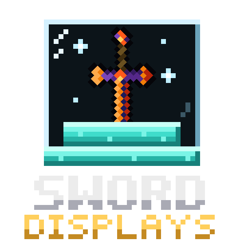

Sword Displays
---


[](https://www.curseforge.com/minecraft/mc-mods/sword-displays)
[](https://www.curseforge.com/minecraft/mc-mods/sword-displays)

Allows the user to display their weapons via the use of a sword display block.

## Display Styles

- **Sword Displays, Sword Cases, and Wall Displays** — the original display styles.
- **Weapon Plaques** — decorative, classic Minecraft-inspired displays for showcasing individual weapons.
- **Weapon Racks** — multi-weapon displays capable of holding up to 3 swords or weapons at once, with independent 45° rotation per weapon, including horizontal rotation.

Every display style supports over 200 material options, from wood and stone to ores, nether/end blocks, and colored blocks/wool/concrete/terracotta variants.

## Configuration

Settings can be edited in-game from the Mods list, or via the config file. Each display family (Original, Plaques, Racks) has a master "enabled" toggle that overrides its individual display/case/wall options, so whole groups can be disabled at once.

## Adding Custom Weapons

Displays accept any item tagged `minecraft:swords`, `minecraft:axes`, or `minecraft:enchantable/weapon`, so most modded weapons are already supported automatically.

If a weapon doesn't fall under one of those tags, it can be added to the mod's own `sworddisplay:swords` item tag via a data pack, e.g. `data/sworddisplay/tags/items/swords.json`:

```json
{
  "values": [
    "yourmod:your_weapon"
  ]
}
```

## Comparator Caculations

```java
        // x = maxDamage : (maxDamage - currentDamage)
// if (x > 15) x = 14;
// if (x == 15) x = 13;
// return 15 / x
int x = stack.getMaxDamage() / (stack.getMaxDamage() - stack.getDamage());
x = x > 15 ? 14 : x == 15 ? 13 : x;
        return 15 / x;
```
